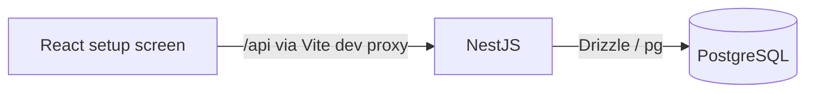

# Architecture

## Current system

TypeScript workspace with NestJS, React/Vite, and PostgreSQL via Drizzle and node-postgres. Drizzle defines the domain schema; versioned SQL migrations and a repeat-safe seed command establish the take-home fixtures. Document submissions and independent QC are implemented in `apps/api/src/documents`; readiness and scheduling remain deferred.

| Layer | Manifest-pinned tools | Current responsibility |
|---|---|---|
| Workspace | pnpm 10.19.0, Turbo 2.11.10, TypeScript 5.9.3 | Coordinate packages, builds and checks. |
| API | NestJS 12.3.3, Drizzle ORM 0.45.4, pg 8.23.1 | Health, document workflow, scoped access, transactional audit and database CLI. |
| Web | React 19.3.1, Vite 8.3.6 | Setup screen checking API health. |
| Database | PostgreSQL 16 Alpine; Drizzle Kit 0.31.11 | Local database with generated, versioned SQL migrations. |
| Checks | Oxlint 1.91.0, Jest 30.5.2, Supertest 7.3.1, Vitest 5.1.0 | Static checks, setup, document HTTP and SQL/CLI database tests. |

Versions describe repository manifests, not claims about the latest available releases.

## Pattern and boundaries

The [plan](../plan.md) selects a small modular monolith. The document module separates HTTP parsing, transactional use cases and shared order-lock/audit helpers.

```text
apps/api/src/          Nest application and database provider
apps/api/test/         API integration tests
apps/web/src/          React application and component tests
packages/contracts/   Shared wire types only
infra/postgres/        Initial test-database creation
```



The applications run locally; Compose runs PostgreSQL. This is not a production deployment architecture.

## Planned behavior and trade-offs

- Two document endpoints are implemented; the remaining four endpoints and readiness board in [plan.md](../plan.md#api-ui-and-assumptions) remain deferred. See [current endpoint contracts](../DECISIONS.md).
- Keep runtime validation in the API; shared TypeScript wire types do not validate requests.
- Keep persistence internals out of `packages/contracts` and the browser.
- Reuse one readiness evaluator for reads and scheduling. Serialize readiness-changing writes per job order, then lock the appointment for booking; see [ADR-0002](adrs/adr-0002-order-locking.md).
- Authorize before replay lookup. Commit submission receipts, versions, tasks and audit effects together.

| Priority | Consequence |
|---|---|
| Integrity | Retries and concurrency must preserve history and capacity. |
| Simplicity | Same-order serialization sacrifices throughput for a smaller correctness surface. |
| Security | Role, branch and ownership checks must run on the server. |
| Delivery | Implement the scoped slice before optional features. |

## Related docs

- [Decisions](adrs/README.md)
- [Data model](data-model.md)
- [Infrastructure](infrastructure.md)
