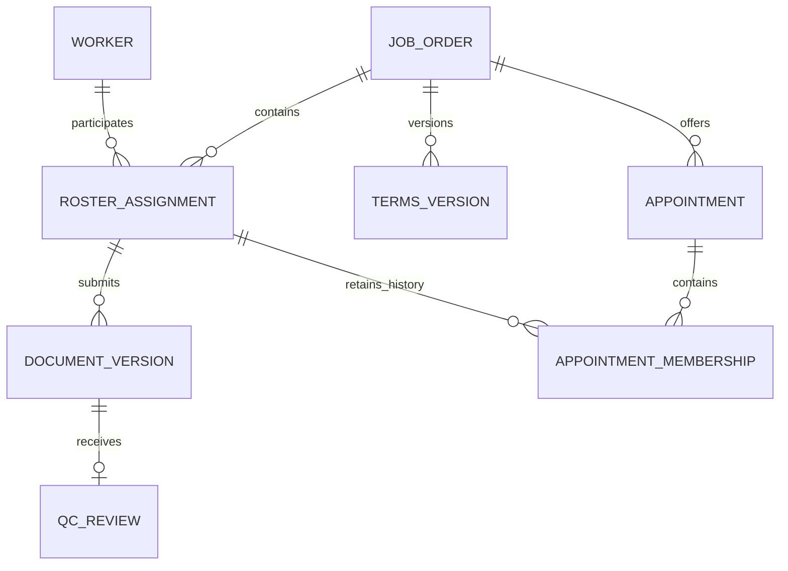

# Data model

## Implementation status

No domain schema or migrations are implemented. This is a conceptual model from the brief and [plan.md](../plan.md), not a description of existing SQL tables, columns or indexes.

Drizzle ORM and Drizzle Kit are installed. The migration directory, configuration and generation/application commands remain unspecified. Do not use schema synchronization as a substitute for reviewed migrations.

## Planned entities

| Entity group | Purpose and relationships |
|---|---|
| Branches, users and roles | Scope staff access; worker users act only on their own assignments. |
| Job-order stub and terms versions | Reference the case system's external order ID; track current and historical terms. |
| Workers and roster assignments | Persistent worker identity; one assignment connects a worker to one order and an owning capturist. |
| Employer decisions and acceptances | Evidence for hiring approval and acceptance of a specific terms version. |
| Required document types and document versions | Order requirements and immutable submissions for an assignment. |
| QC reviews and tasks | Independent final decisions per version; deduplicated correction work. |
| Appointments and memberships | Order appointments, capacity and active assignment bookings. |
| Audit log | Actor, represented user, entity, field, old/new values and timestamp for state changes. |
| Submission receipts | Planned addition for canonical requests and original replay responses. |

## Conceptual relationships

Diagram names are conceptual, not final table names. Historical memberships may coexist; the plan permits only one active booking per assignment.

## Planned integrity rules

- Preserve records by archival, cancellation or supersession, not hard deletion (R2).
- Preserve immutable submission payloads; store QC decisions separately (R2, R7).
- Choose the most recent approved document, or latest submitted when none is approved; a pending replacement cannot displace approval (R6).
- Make `(userId, clientSubmissionId)` unique. Identical replay returns the original response; changed content with the same key returns 409 (R5).
- Enforce one assignment per worker/order and one active booking per assignment, not one lifetime booking per worker (R1, R10).
- Back relationships and valid values with foreign keys, uniqueness, status checks and positive-capacity constraints. Exact definitions are pending.
- Write audit effects transactionally; refusals and replays must not change domain history (R3, R5, R9).

## Access control

The brief uses `X-User-Id` to select a caller; authentication is out of scope. Authorization is still required and not yet implemented. The plan requires server-side role, branch and ownership checks; it does not establish a PostgreSQL RLS implementation.

Planned errors: 403 for missing/unknown callers or insufficient roles; 404 for missing/inaccessible records; 400 for invalid input; 409 for conflicting operations.

## Related docs

- [Business rules](business.md)
- [Scheduling decision](adrs/adr-0002-order-locking.md)
- [Original requirements and seeds](../odd/tasks/worker-operations.md)
